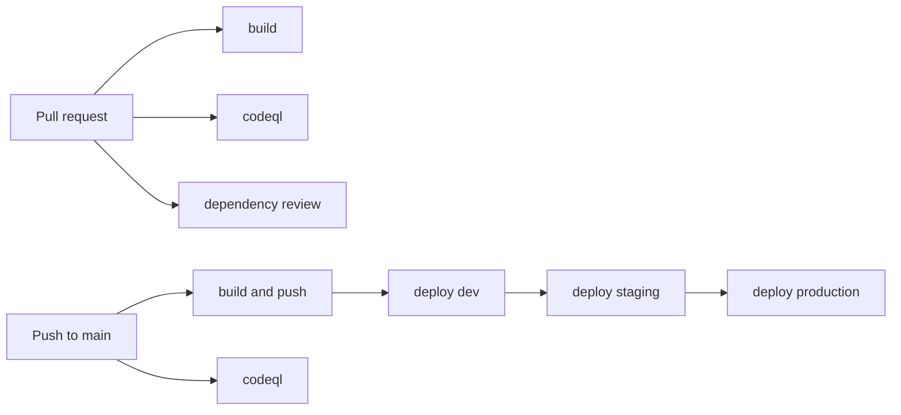

# pipeline-templates

Reusable GitHub Actions workflows and composite actions for build, test and deploy.
Application repositories keep a single short `pipeline.yml` and call these templates by
version. Improvements to the templates reach every application through a version bump
instead of copy and paste.

Example applications that use these templates:

- [hello-java-pipeline](https://github.com/christianlehnert/hello-java-pipeline)
- [hello-dotnet-pipeline](https://github.com/christianlehnert/hello-dotnet-pipeline)

## Contents

| Path | Type | Purpose |
|---|---|---|
| `.github/workflows/build-java.yml` | Reusable workflow | Maven build and tests, container image, smoke test, optional push to ghcr.io |
| `.github/workflows/build-dotnet.yml` | Reusable workflow | .NET build and tests, publish, container image, smoke test, optional push to ghcr.io |
| `.github/workflows/deploy.yml` | Reusable workflow | Deploy one image to one GitHub environment (approval gates apply) |
| `.github/workflows/codeql.yml` | Reusable workflow | CodeQL code scanning without a build |
| `.github/workflows/dependency-review.yml` | Reusable workflow | Fail pull requests that add vulnerable dependencies |
| `actions/container-publish` | Composite action | Build an image with Buildx, push by digest or load locally |
| `actions/smoke-test` | Composite action | Start an image and wait for its health endpoint to return 200 |
| `.github/workflows/_selftest.yml` | Workflow | Lints this repository and tests the composite actions |
| `.github/workflows/_release.yml` | Workflow | Moves the major tag (for example `v1`) when a release tag is pushed |

## How an application uses the templates



A complete `pipeline.yml` for a Java application:

```yaml
name: pipeline

on:
  pull_request:
  push:
    branches: [main]

permissions:
  contents: read

concurrency:
  group: pipeline-${{ github.ref }}
  cancel-in-progress: ${{ github.event_name == 'pull_request' }}

jobs:
  dependency-review:
    if: github.event_name == 'pull_request'
    uses: christianlehnert/pipeline-templates/.github/workflows/dependency-review.yml@v1
    permissions:
      contents: read

  codeql:
    uses: christianlehnert/pipeline-templates/.github/workflows/codeql.yml@v1
    with:
      language: java-kotlin
    permissions:
      contents: read
      security-events: write
      actions: read

  build:
    uses: christianlehnert/pipeline-templates/.github/workflows/build-java.yml@v1
    with:
      app: hello-java
      push: ${{ github.event_name == 'push' && github.ref == 'refs/heads/main' }}
    permissions:
      contents: read
      packages: write

  deploy-dev:
    if: github.event_name == 'push' && github.ref == 'refs/heads/main'
    needs: [build, codeql]
    uses: christianlehnert/pipeline-templates/.github/workflows/deploy.yml@v1
    with:
      app: hello-java
      environment: dev
      image: ${{ needs.build.outputs.image }}
    permissions:
      contents: read
      packages: read
```

`deploy-staging` and `deploy-production` follow the same pattern with `needs` on the
previous stage. Approvals are not part of the YAML: they are configured on the GitHub
environments (Settings, Environments, Required reviewers).

## Inputs and permissions

### build-java

| Input | Required | Default | Description |
|---|---|---|---|
| `app` | yes | | Image name (lowercase letters, digits, dashes) |
| `java-version` | no | `21` | Java version |
| `working-directory` | no | `.` | Directory with `pom.xml` and `Dockerfile` |
| `push` | no | `false` | Push the image to ghcr.io |
| `port` | no | `8080` | Container port for the smoke test |
| `health-path` | no | `/health` | Health endpoint for the smoke test |

Output: `image`. Calling job permissions: `contents: read`, `packages: write`.
The Dockerfile is expected to copy the jar built by Maven from `target/`.

### build-dotnet

| Input | Required | Default | Description |
|---|---|---|---|
| `app` | yes | | Image name (lowercase letters, digits, dashes) |
| `project` | yes | | Project to publish, relative to `working-directory` |
| `dotnet-version` | no | `10.0.x` | .NET SDK version |
| `working-directory` | no | `.` | Directory with the solution and `Dockerfile` |
| `push` | no | `false` | Push the image to ghcr.io |
| `port` | no | `8080` | Container port for the smoke test |
| `health-path` | no | `/health` | Health endpoint for the smoke test |

Output: `image`. Calling job permissions: `contents: read`, `packages: write`.
The Dockerfile is expected to copy the folder `publish/`.

### deploy

| Input | Required | Default | Description |
|---|---|---|---|
| `app` | yes | | Application name |
| `environment` | yes | | GitHub environment, for example `dev`, `staging`, `production` |
| `image` | yes | | Image reference with digest from a build workflow |
| `port` | no | `8080` | Container port for the smoke test |
| `health-path` | no | `/health` | Health endpoint for the smoke test |

Calling job permissions: `contents: read`, `packages: read`.

The deploy step is a placeholder: it verifies that the image starts and records the
deployment in the job summary. Replace it with the deployment for your platform, for
example Azure Container Apps with an OpenID Connect login. Applications do not change
when the deploy step changes, only the template version does.

### codeql

| Input | Required | Default | Description |
|---|---|---|---|
| `language` | yes | | CodeQL language, for example `java-kotlin`, `csharp` |
| `build-mode` | no | `none` | CodeQL build mode |

Calling job permissions: `contents: read`, `security-events: write`, `actions: read`.

### dependency-review

| Input | Required | Default | Description |
|---|---|---|---|
| `fail-on-severity` | no | `high` | Lowest severity that fails the check |

Calling job permissions: `contents: read`. Call it only for `pull_request` events.

## Versioning

Releases follow [Semantic Versioning](https://semver.org).

| Change | Release | Effect on applications using `@v1` |
|---|---|---|
| Bug fix | `v1.0.1` | Picked up automatically |
| New optional input | `v1.1.0` | Picked up automatically |
| Removed input or changed behaviour | `v2.0.0` | Applications switch to `@v2` when ready |

To release, push a version tag. The release workflow then moves the major tag:

```bash
git tag v1.1.0
git push origin v1.1.0
```

The reusable workflows reference the composite actions of this repository at `@v1`.
The first release (`v1.0.0`, which also creates `v1`) must therefore exist before an
application can call the templates.

Third-party actions are pinned to full commit SHAs with the version as a comment.
Dependabot proposes updates as pull requests.

## Testing

### In GitHub

The `selftest` workflow runs on every pull request and on pushes to `main`:

- `actionlint` and `shellcheck` on all workflows and scripts.
- The composite actions are run from the working tree (`uses: ./actions/...`) against
  the fixture image in `tests/fixtures/web`, so changes to them are tested before release.

### Locally with act

[act](https://nektosact.com) runs workflows locally in Docker and catches most mistakes
before they are committed. It requires Docker Engine.

```bash
# list jobs for an event
act pull_request -l

# run the composite action test of the selftest
act pull_request -W .github/workflows/_selftest.yml -j actions

# jobs that need a token
act pull_request -W .github/workflows/_selftest.yml -s GITHUB_TOKEN="$(gh auth token)"
```

act does not reproduce everything. According to its documentation, environments and their
protection rules, `concurrency`, `permissions`, `timeout-minutes` and OpenID Connect are not
supported, and step summaries are discarded. Use act for fast feedback and GitHub for the
full run.

## Further reading

- [Reuse workflows](https://docs.github.com/en/actions/how-tos/reuse-automations/reuse-workflows)
- [Metadata syntax for composite actions](https://docs.github.com/en/actions/reference/workflows-and-actions/metadata-syntax)
- [Deployments and environments](https://docs.github.com/en/actions/reference/workflows-and-actions/deployments-and-environments)
- [Secure use reference](https://docs.github.com/en/actions/reference/security/secure-use)
- [act documentation](https://nektosact.com)

## License

[MIT](LICENSE)
